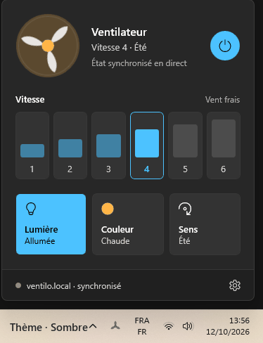

# ventilo-widget

**VentiloTray** : une icône dans la zone de notification de Windows 11 ; un
clic ouvre un panneau de contrôle du ventilateur de plafond piloté par
[ventilo-controller](https://github.com/Miitos/ventilo-controller)
(API : [API.md](https://github.com/Miitos/ventilo-controller/blob/main/API.md)).



- Vitesses 1 à 6, marche/arrêt, lumière, couleur, sens de rotation
- État synchronisé en direct avec le boîtier, télécommande physique comprise
- Thèmes Système, Sombre, Clair et thèmes de saison animés (Sakura, Automne,
  Hiver, Nuit d'été) : les particules suivent la vitesse du ventilateur
- Icône de barre des tâches avec la vitesse, lancement au démarrage

WinUI 3 (Windows App SDK 1.5, embarqué), .NET 8, non empaqueté.

## Installer / mettre à jour

```powershell
Stop-Process -Name VentiloTray -ErrorAction SilentlyContinue
dotnet publish .\VentiloTray\VentiloTray.csproj -c Release -r win-x64 --self-contained true -o "$env:LOCALAPPDATA\Programs\VentiloTray"
```

Raccourci menu Démarrer : `Ventilo`. Au lancement, si « Lancer au démarrage »
est activé, la clé `Run` est réécrite vers l'exécutable courant.

Lancé sans argument, le panneau s'ouvre une fois. Avec `--tray` (utilisé par
le démarrage auto), l'app reste discrète dans la barre.

`--demo=<Thème>` (`Dark`, `Light`, `Sakura`, `Autumn`, `Winter`, `Summer`) ouvre
un panneau figé pour les captures : allumé vitesse 4, lumière allumée, ne se
ferme pas, n'envoie rien et n'écrit rien. Sert à produire `docs/themes.gif`.

Windows 11 range les nouvelles icônes dans le menu `^` (et rattache ce choix au
chemin de l'exécutable) : glisser l'icône hélice sur la barre des tâches.

## Fichiers

| Fichier | Rôle |
|---|---|
| `FlyoutWindow.xaml(.cs)` | Le panneau : UI, inertie de l'hélice, commandes, synchro, paramètres |
| `Decor.cs` | Thèmes de saison : motif du coin + particules (pétales, feuilles, neige, lucioles) |
| `Palette.cs` | Couleurs des thèmes ; liste des thèmes du sélecteur |
| `FanClient.cs` | Commandes HTTP (espacées de 450 ms), flux SSE `/events`, correction d'état |
| `AppSettings.cs` | Réglages + dernier état, dans `%LOCALAPPDATA%\VentiloTray\settings.json` ; démarrage auto (clé `Run` HKCU) |
| `TrayIcon.cs`, `Native.cs` | Icône de notification en Win32 (WinUI 3 n'en fournit pas) |
| `IconRenderer.cs` | Dessin de l'icône : hélice + pastille de vitesse, à la taille système |

## État

Le firmware tient l'état (télécommande physique comprise) et le publie sur
`/events` : l'app s'y abonne et se reconnecte seule. Pied du panneau :
« synchronisé » quand c'est le cas. Sans firmware compatible, l'app retombe
sur l'état supposé (ce qu'elle a envoyé).

Paramètres → « Corriger l'état » : corrige l'app et le firmware, sans rien
émettre vers le ventilateur.

## Pièges de build

- `UseRidGraph=true` + `RuntimeIdentifiers=win-x64` : sinon le SDK 8.0.2xx
  rejette les RID `win10-*` ajoutés par le Windows App SDK 1.5.
- `EnableMsixTooling=true` : sinon la tâche PRI cherche un assembly Visual
  Studio absent avec le seul SDK .NET.
